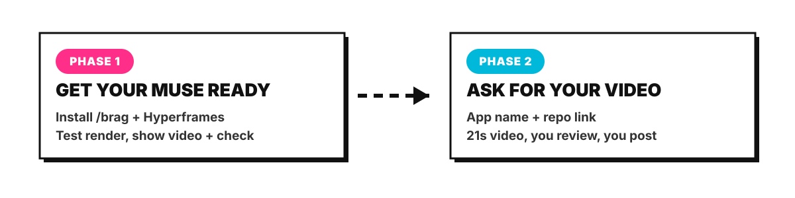

<p align="center"></p>

<h1 align="center">/brag Guide — You built it. Now brag.</h1>

<p align="center">
  <a href="https://brag-guide.funapp.live"></a>
  <a href="LICENSE"></a>
  <a href="https://github.com/latent-spaces/brag"></a>
  
  
</p>

<p align="center"><strong>Use <a href="https://github.com/latent-spaces/brag">/brag</a> with Muse.</strong> Your Muse installs it, tests it, and turns your project into a short launch video — motion, music, share copy and all. One command. No video editor.<br>📖 Read the guide in English and Burmese → <a href="https://brag-guide.funapp.live">brag-guide.funapp.live</a></p>

## 🎬 Watch it — the guide's own launch video

<p align="center"><a href="https://brag-guide.funapp.live"></a></p>

<p align="center"><em>21 seconds, made with /brag — the same way this guide teaches. Click the poster to open the guide.</em></p>

## 🧭 How it works

<p align="center"></p>

1. **Get your Muse ready.** Install /brag + Hyperframes on the Muse's own machine, prove it with a test render on a bundled example, show the test video and the check result. Make nothing real yet.
2. **Give it your project.** App name + repo link. The Muse makes the video, shows video + frames first, you review, then you download and post it yourself. One video, one Muse at a time.

## 🚀 Quick start

```bash
# Codex
codex plugin marketplace add latent-spaces/brag
codex plugin add brag@brag

# Claude Code
/plugin marketplace add latent-spaces/brag
/plugin install brag@brag

# Any other agent
npx skills add https://github.com/latent-spaces/brag --skill brag
```

Then, inside any project:

```bash
/brag
```

Your video appears in `brag-output/brag.mp4`.

## 📦 What's inside

| Path | What it is |
|---|---|
| 🌐 `site/index.html` | The guide website — 8 tabbed sections, English + Burmese toggle |
| 🎬 `site/assets/brag.mp4` | The verified PocketLab demo video (21s, 1920×1080, 30fps) |
| 🖼️ `site/assets/brag.jpg` | The demo poster frame |
| 🎬 `site/assets/guide-video.mp4` | The guide's own launch video (21s, music + sound effects) |
| 🖼️ `site/assets/guide-video.jpg` | The guide video poster frame |
| 🎨 `assets/banner.svg` | Animated Pop Art banner art |
| 🧭 `assets/how-it-works.svg` | Animated two-phase flow diagram |
| 📚 `docs/` | The same content as short Markdown chapters, one file per section |
| 🛠️ `scripts/` | Builders for the site and the Burmese strings |

## ✅ Verified, not promised

Every step in this guide was run end-to-end on a test machine on 2026-11-10:

- ✅ Codex plugin install works; Hyperframes 0.9.30 renders.
- ✅ Test video: PocketLab, 21 seconds, 1920×1080, 30 fps, 1.5 MB, music + sound effects. Burmese hero line renders correctly.
- ✅ Hyperframes check: 0 errors, 33/33 contrast passed.
- ✅ Two fixes needed on the test machine are documented in `docs/06-troubleshooting.md` (low disk on `/tmp`, GSAP CDN failure).

Things **not** tested are listed honestly in `docs/07-limits.md` (Claude Code run, Codex agent run with auth, audio-reactive visuals, Windows install).

## 🔗 Links

- 🌐 Live guide: https://brag-guide.funapp.live
- ⬆️ Upstream: https://github.com/latent-spaces/brag
- 📖 Docs: https://latent-spaces.github.io/brag
- 🎬 Hosted: https://letsbrag.app
- 🍴 Fork: https://github.com/mymyanmarland/brag

## 📄 License

MIT — see [LICENSE](LICENSE). /brag itself is MIT by latent-spaces.
